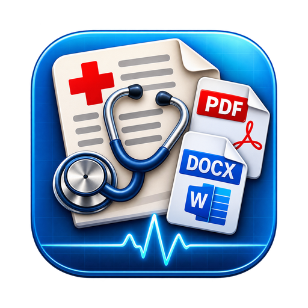

# Chartwell

A native macOS app that turns a JSON file of encounter records into clean, form-ready PDF and Word (.docx) documents.

Chartwell reads your records, groups visits by facility, lets you fill in addresses once, and exports a polished log you can hand to someone who needs it in a specific layout. Everything runs locally. Nothing is uploaded and there are no network calls.

## Features

- Load a records JSON file and browse every encounter in a searchable table
- Visits are grouped by facility, the way a paper treatment-log form does it
- Click an address once per facility and it fills in everywhere that facility appears
- Printed name option: use the name from the records file, or type your own
- Export to PDF (Core Graphics, no dependencies)
- Export to Word (.docx, built from scratch with a tiny zip writer, no dependencies)
- Filters apply to exports, so you can export a subset
- Remembers the last file you opened

## Requirements

- macOS 10.13 (High Sierra) or later
- Xcode 10.1 or later to build (Swift 4.2, no third-party packages)

## Build

    git clone https://github.com/smokeluce/chartwell.git
    cd chartwell
    open Chartwell.xcodeproj

Press Cmd+R in Xcode.

## Records format

Chartwell expects a JSON file with a list of encounters. The full field list is in [docs/JSON_FORMAT.md](docs/JSON_FORMAT.md), and [docs/demo_records.json](docs/demo_records.json) is a complete fake example (34 encounters) you can open to try the app.

## Privacy

- Your records file is read in place and never copied or sent anywhere
- Addresses you enter and your name setting are stored locally in the app's preferences on your Mac
- App Sandbox is turned off so the app can reopen your last file at launch
- The .gitignore excludes `private/`, `*Medical*.json`, `*Encounters*.json`, and generated `.pdf` and `.docx` files, so real records are hard to commit by accident

## Project layout

    Chartwell/
      AppDelegate.swift         window setup
      MainViewController.swift  main window, table, export actions
      NameOptionView.swift      printed-name control
      Encounter.swift           record model and JSON loading
      Grouping.swift            groups visits by facility
      AddressBook.swift         per-facility addresses
      Settings.swift            stored options
      PDFExporter.swift         PDF layout
      DocxExporter.swift        Word layout
      ZipWriter.swift           minimal zip writer for .docx
      Theme.swift               colors
    docs/
      JSON_FORMAT.md
      demo_records.json

## Roadmap

- App icon
- Build and version label in the app
- Repeat the facility name when a table continues onto a new page in the Word export

## License

Not yet chosen.
